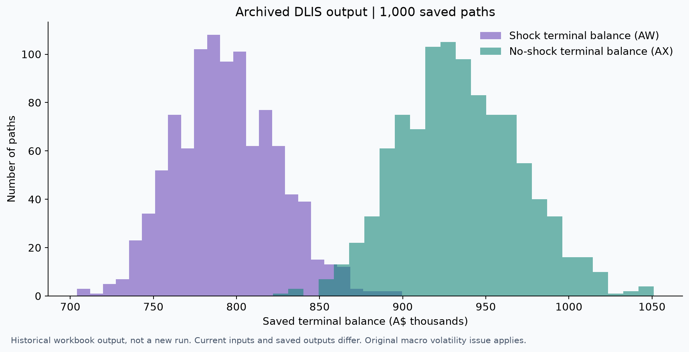

# 生命周期模型与演示

[返回首页](../README.md) · [五分钟演示步骤](../docs/demo-guide.md) · [模型检查记录](../docs/model-review.md)

[**下载 Excel 宏工作簿**](https://github.com/pythonerjavaer/finance-decision-case-studies/raw/refs/heads/main/models/DLIS-Model.xlsm)

## 模型内容

| 工作表 | 用途 |
| --- | --- |
| Instructions | 原始来源、使用范围及界面说明 |
| Input | 年龄分段、投资选项、工资、缴费和冲击参数 |
| Analysis | 情景均值、标准差、极值及图表 |
| Return Data | 四类投资策略的收益、波动及冲击参数 |
| Output（隐藏） | 逐路径模拟输出 |
| SGR | 原模板附带的缴费率资料 |

工作簿包含 VBA。Input 页的 **Run Simulation** 按钮关联 `GeneratePaths` 宏。模型需要下载到支持 VBA 的桌面 Excel 中运行。GitHub 用于展示文件与说明；Excel 网页版不能运行 VBA，见[微软说明](https://support.microsoft.com/en-us/excel/work-with-vba-macros-in-excel-for-the-web)。

## 保存结果预览

图表直接提取隐藏 Output 页 AW3:AX1002 两列的历史终值。它与原宏末尾写入“冲击终值／无冲击终值”的结构对应，**不是本次重新运行产生的结果**。当前 Input 和保存输出的年龄范围不一致，不能据此将图表解释为当前参数的计算结果。宏的波动率问题也适用于解释这些历史输出。

## 文件来源与完整性

此文件是用户提供的原始工作簿，仅重命名，内容未改写。原始文件名：`Copy of FINC3600 S2 2023 DLIS Model final (TK)-1 1.xlsm`。

SHA-256：`b9f6e703ec91fdab61cecd6e65ad92dd36e7c7985ffa5ac8df952def1ff636f7`

底层模板的 Instructions 页声明其知识产权属于 University of Sydney Business School。保留原有署名与声明；本仓库不对第三方模板授予新的开源许可。项目贡献侧重参数设定、模拟应用、策略比较与结果解释，详见[贡献说明](../docs/contribution.md)。

## 验证范围

已经检查工作表、公式、命名区域、按钮绑定、VBA 源码与历史输出，未发现外部工作簿链接。本次环境没有桌面 Excel，因此**未完成 Excel 内的执行验收**。目前发布的是原模型与演示说明，不能将其描述为已修正、已完整验证的生产模型。请先阅读[已知问题](../docs/model-review.md)，运行时另存个人副本。
